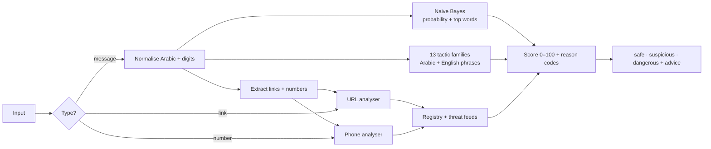
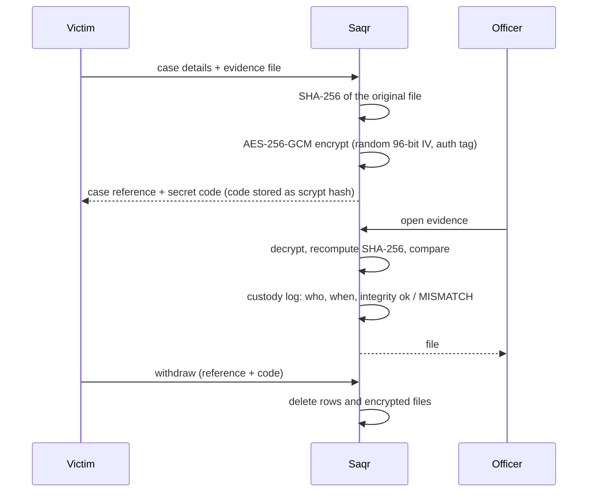

# Saqr — technical documentation

This document explains how Saqr works inside: the system architecture, the detection model, the privacy design, the data model, the API, the mobile app and how everything is tested. The [README](../README.md) covers the problem, the features and how to run Saqr. [RESEARCH.md](RESEARCH.md) holds the UAE facts, the law and the comparison with existing services.

**Contents**
1. [System overview](#1-system-overview)
2. [Detection engine](#2-detection-engine)
3. [Measured performance](#3-measured-performance)
4. [Privacy and security design](#4-privacy-and-security-design)
5. [Authority features](#5-authority-features)
6. [Data model](#6-data-model)
7. [API reference](#7-api-reference)
8. [Mobile app](#8-mobile-app)
9. [Testing and quality](#9-testing-and-quality)
10. [Deployment and operations](#10-deployment-and-operations)
11. [Limitations and roadmap](#11-limitations-and-roadmap)

---

## 1. System overview

Saqr is one Node.js service with one SQLite database, plus three clients that use the same JSON API: the website, the authority dashboard and the Flutter app for iPhone and Android.

```mermaid
flowchart TB
  subgraph Clients
    W[Website<br/>scan · report · registry · practice · help]
    D[Authority dashboard]
    F[Family pages<br/>guardian + elder]
    M[Flutter app<br/>iOS + Android]
    X[iOS SMS filter<br/>on-device]
  end
  subgraph Server[Saqr server — Node.js 22, Express 5]
    API[REST API<br/>helmet CSP · rate limits · size limits]
    ENG[Detection engine]
    SVC[Reports · registry · review]
    RAD[Campaign radar]
    CAS[Extortion cases + evidence vault]
    FAM[Family alerts]
    FEED[Threat feeds + scam phrases]
  end
  DB[(SQLite)]
  VAULT[(Encrypted evidence files)]
  W & D & F & M --> API
  M -. no connection .-> OFF[On-device engine<br/>Dart port]
  API --> ENG & SVC & RAD & CAS & FAM & FEED
  SVC & RAD & CAS & FAM & FEED --> DB
  CAS --> VAULT
  DB -. verified reports retrain .-> ENG
  FEED -. GitHub / abuse.ch lists every 12 h .-> DB
```

| Layer | Technology | Notes |
|---|---|---|
| Server | Node.js 22, Express 5 | One process, starts with `npm start`. |
| Storage | SQLite (better-sqlite3, WAL mode) | One file, plain SQL schema, easy to move to PostgreSQL. |
| Evidence | Files encrypted with AES-256-GCM | Key outside the database. |
| Web clients | Vanilla HTML, CSS and JS | No build step, no CDN, strict Content-Security-Policy. |
| Mobile | Flutter 3.27+ (Dart 3) | One codebase for iOS and Android, built in GitHub Actions. |
| iOS SMS filter | Swift, IdentityLookup | Runs on the phone, the message never leaves it. |

**Code size:** about 6,900 lines across the server, web and mobile code.

---

## 2. Detection engine

`src/engine/` holds the whole detector. It runs locally: no external AI service, no network call and no link is ever opened.

### 2.1 Pipeline



1. **Type detection.** A number is digits, spaces, `+`, `-` and brackets with at least 3 digits. A link has no spaces and looks like a URL or a domain. Anything else is a message.
2. **Normalisation** (`normalize.js`). Arabic-Indic and Persian digits become 0–9. Diacritics and tatweel are removed. أ إ آ ٱ become ا, ى becomes ي, ة becomes ه, ؤ becomes و, ئ becomes ي. Text is lower-cased. This makes Gulf-dialect and standard spellings look the same to the model and the rules.
3. **Scoring** (below) produces a score and a list of **reason codes** with parameters, for example `tactic_credentials {terms: ["عطني الكود"]}`. The client translates each code into Arabic or English. The engine never returns free text, so explanations are always available in both languages.

### 2.2 Language model

A multinomial Naive Bayes classifier (`classifier.js`) with unigrams and bigrams and Laplace smoothing.

- **Training data:** 103 hand-written bilingual examples (50 scam, 53 normal) in `dataset.js`, covering Gulf dialect, standard Arabic and English. Every message an authority verifies or rejects is added through the learning loop.
- **Tokens:** links, numbers and digits become `__url__`, `__phone__` and `__num__`, so the model learns "contains a link" rather than a particular link. Stop words are removed.
- **Few-word guard:** if fewer than two known words appear, the probability is pulled towards 0.5. Short texts cannot swing the verdict on their own.
- **Explanation:** the five words that pushed most towards "scam" are returned and shown to the user.
- **Learning loop:** verifying or rejecting a reported message stores it in `learned_samples` and retrains immediately. Training takes milliseconds.

### 2.3 Fraud-tactic rules

`message.js` defines 13 tactic families, each with Arabic (dialect and standard) and English phrases, points, a severity and, for strong tactics, a **floor**. A floor is the minimum score once the tactic is present.

| Tactic | Points | Floor | Examples |
|---|---|---|---|
| credentials | 26 | 55 | عطني الكود · وصلك كود · OTP · password |
| personal_data | 14 | 40 | حدث بياناتك · صورة الهوية · card number |
| threat | 16 | 35 | تم إيقاف · حجز المركبة · قضية ضدك |
| prize | 18 | 40 | مبروك ربحت · جائزة · you won |
| investment | 18 | 40 | أرباح مضمونة · ضاعف فلوسك |
| job | 14 | 35 | عمل من البيت · راتب يومي |
| new_number | 14 | 40 | هذا رقمي الجديد |
| payment | 14 | — | ادفع · رسوم · تحويل |
| urgency | 12 | — | خلال 24 ساعة · فوراً |
| call_to_action | 10 | — | اضغط على الرابط · click here |
| impersonation | 8 | — | الشرطة · البنك · موظف البنك |
| off_platform | 8 | — | كلمني واتساب · Telegram |
| parcel | 6 | — | شحنتك · التوصيل |

Short Arabic words (four letters or fewer) only match as whole words, with an optional prefix (و ف ب ل ال وال بال). This stops "حول" from matching inside "تحويل". Authorities can add phrases from the dashboard (`custom_terms`), and they take effect immediately.

**Protective notices.** Real OTP messages warn "never share this code". When a message carries that warning and has no link and no payment, prize or threat tactic, the credential and impersonation matches are dropped and the score is capped at 25.

### 2.4 Link analysis (static)

`url.js` reads the link as text and never fetches it.

| Signal | Points |
|---|---|
| Look-alike of a brand (edit distance or homoglyphs: paypa1, rnashreq) | 60 |
| Brand name on an unofficial domain (emiratesnbd-secure.top) | 48 |
| `gov.ae` used outside the real suffix, authority name on an unofficial domain | 45 |
| IP address host, punycode or non-Latin characters | 30 |
| Phishing words in host or path (login, verify, pay, fine…), 11 each | up to 30 |
| `@` in the authority part | 25 |
| Link shortener | 25 |
| UAE word plus phishing words (uae-pay-fines) | 22 |
| Free hosting (netlify.app, web.app, blogspot.com…) | 20 |
| Risky top-level domain (.top, .xyz…) | 18 |
| Unknown domain, plain http, odd port, many subdomains or hyphens, long link | 5–10 |
| Official (`gov.ae`, `ae` government) or trusted domain | −10, then stop |

Then the community registry and the threat feeds are checked. A verified or feed-listed indicator lifts the score to at least 90.

### 2.5 Number analysis

`phone.js` normalises to E.164 with the UAE numbering plan: local `05x` and `0x` forms, `00` prefixes, emergency numbers (999, 998, 997, 996), 800 and 600 service numbers, mobile and landline ranges. International numbers add 24 points and known premium-rate ranges add 50. The registry and feeds are then checked the same way as links.

### 2.6 Combining the signals

For a message:

```
score = round(50 × P(scam))
      + min(sum of tactic points + combo bonuses, 50)
      + round(0.5  × highest link score)
      + round(0.35 × highest number score)
```

then, in order:

1. **No evidence beyond wording.** If no tactic, link or number is found, the score is capped at 25, or at 45 when the model is at least 97% sure. Bank alerts and OTP notices use scam-like words. This rule keeps them from being flagged on language alone.
2. **Protective notice** caps the score at 25 (2.3).
3. **Floors.** The score is raised to the highest floor among the tactics found.
4. **Several strong tactics.** Two or more tactics other than impersonation, parcel and off-platform raise the score to at least 55, plus 8 for each extra one.
5. **Combo bonuses** (already in the tactic sum): impersonating an authority together with a credential, payment, data or threat request, or a link, adds 15. An "official" message with a personal mobile number adds 10.

**Levels:** 0–29 safe, 30–64 suspicious, 65–100 dangerous. Each level comes with its own advice list.

---

## 3. Measured performance

`npm run evaluate` runs two tests and prints every error.

**Leave-one-out on the dataset.** Each of the 103 messages is scored by a model trained on the other 102, so the model has never seen the message it is judging.

| | Value |
|---|---|
| Recall (scams flagged as suspicious or dangerous) | **100%** (50 of 50) |
| Precision (flagged messages that are scams) | **92.6%** |
| F1 | 96.2% |
| Accuracy | 96.1% |
| Scams rated *dangerous* (not just suspicious) | 36 of 50 |

The 4 false alarms are all rated *suspicious*, never *dangerous*: two card-purchase alerts, a bill payment receipt and a delivery update. They share the vocabulary of scams (card, AED, payment, delivery).

**Held-out practice bank.** The 32 messages of the practice game (18 scam, 14 normal) are not in the training set. All 32 are classified correctly.

**Be careful with these numbers.** The dataset is small and was written by the team. The rules were tuned while looking at it, so the leave-one-out figure is optimistic for real-world traffic. A real deployment needs a larger labelled set from police reports. The learning loop is built to collect exactly that.

---

## 4. Privacy and security design

### 4.1 Privacy by design

| Data | What Saqr does |
|---|---|
| Scanned text | Never stored. Only a daily counter (day, type, verdict). |
| Reporter identity | No accounts. Duplicate reports are detected with `HMAC-SHA256(secret, IP + date)`. The fingerprint changes every day and cannot be reversed. |
| Victim data in reports | Card numbers (Luhn-checked), Emirates ID, IBAN, emails, OTP codes and passport numbers are removed before storage (`redact.js`). The scammer's links and numbers are kept, because they are the evidence. |
| Links | Never opened by the server. |
| Public registry | Unverified indicators appear only after 3 independent reports, masked, and only by exact lookup. Indicators only, never people's names. |
| Extortion cases | No identity unless the victim leaves a contact. Details and evidence encrypted. The victim can withdraw and erase. |
| Family mode | Guardians see the verdict and the tactics. The message text only if the elder ticks "share". |
| Mobile offline scans | Run entirely on the phone. |
| iOS SMS filter | Runs on the phone. iOS never gives the extension network access for this. |

### 4.2 Evidence vault and chain of custody



- The key comes from `EVIDENCE_KEY` (64 hex characters, or any random secret of 32+ characters, hashed with SHA-256 into a 32-byte key) or a generated `data/evidence.key` file. It is never stored in the database.
- GCM authentication means any change to a file on disk is detected when it is decrypted.
- Every officer action on a case is written to `custody_log`.

### 4.3 Application security

| Control | Implementation |
|---|---|
| Content-Security-Policy | helmet. No inline scripts or styles. Fonts and assets served locally. |
| Passwords | scrypt with a random salt, constant-time comparison. |
| Sessions | Random tokens in an httpOnly, SameSite=Strict cookie, marked Secure in production or behind an https `PUBLIC_URL`. They expire after `SESSION_HOURS`. |
| Rate limits per IP | scan 60/min · report 10 per 10 min · login 5/min · new case 5/hour · family 10/hour. |
| Input limits | JSON body 20 KB (40 MB for evidence and list uploads). Message 5,000 characters, link 2,048, number 32. |
| SQL | Prepared statements only. |
| Accountability | `audit_log` for every admin login, review, export, source change and phrase change. |
| Tokens | Family and elder tokens stored only as SHA-256 hashes. The pairing token travels in the URL fragment, so it never reaches server logs. |
| Threat feeds | Exact host or host+path matching only. Trusted hosts can never be flagged by a feed, so one bad page on a shared platform cannot block the whole platform. |

### 4.4 Legal alignment (UAE)

- **Federal Decree-Law 34/2021 (cybercrime).** The registry lists indicators and never names people, because of the defamation and privacy articles (Arts. 43–44). Cases are handed to the official police channels rather than investigated by Saqr.
- **Federal Decree-Law 45/2021 (PDPL).** Data minimisation, encryption of sensitive data, access logging, and deletion on request (Art. 20). When the platform is run by a police authority, the government and security exclusions of the PDPL may apply.

---

## 5. Authority features

- **Review queue.** Verify, reject or reset each indicator. Verifying or rejecting a message retrains the model.
- **Campaign radar** (`campaigns.js`). Reports are grouped with union-find when they share a link or number, the same registrable domain, or the same template: Jaccard similarity of at least 0.45 on normalised words, so a changed link or amount still matches. A campaign is **spiking** when it has at least 5 reports in the last 48 hours and at least twice as many as in the 48 hours before. One click verifies every indicator of a campaign.
- **Extortion cases.** Status workflow, encrypted evidence viewer with integrity check, custody log.
- **Threat sources.** Built-in feeds (Phishing.Database ≈386k domains, OpenPhish, URLhaus), uploaded lists (for example scam numbers from a telecom operator), enable, disable, refresh.
- **Scam phrases.** Add or import phrases per tactic (`tactic,phrase` lines).
- **Exports.** CSV of verified indicators for telecom operators and banks to block.

---

## 6. Data model

```mermaid
erDiagram
  indicators ||--o{ report_indicators : "appears in"
  reports ||--o{ report_indicators : "mentions"
  cases ||--o{ evidence : has
  cases ||--o{ custody_log : logs
  family_circles ||--o{ family_alerts : receives
  feed_sources ||--o{ feed_indicators : provides
  indicators { int id; text type; text value; text status; int report_count }
  reports { int id; text type; text category; text channel; text emirate; text content_redacted; text reporter_hash }
  scan_stats { text day; text type; text level; int count }
  learned_samples { text text; text label }
  cases { text ref; text code_hash; blob details_enc; text status }
  evidence { int id; text sha256; text file; text iv; text tag }
  custody_log { text action; text actor; text at }
  family_circles { text guardian_hash; text elder_hash }
  family_alerts { text level; text tactics; text text_shared }
  feed_indicators { text key }
  admins { text username; text password_hash }
  audit_log { text actor; text action; text detail }
  custom_terms { text tactic; text phrase }
```

All 15 tables are created in `src/db.js`. `feed_indicators` is a `WITHOUT ROWID` table keyed by the normalised host or host+path, so a lookup is a single index probe even with hundreds of thousands of entries.

---

## 7. API reference

All responses are JSON. Errors are `{ "error": "<code>" }` with a 4xx status, and the client translates the code.

### Public

| Method | Path | Purpose |
|---|---|---|
| POST | `/api/scan` | `{type: auto|message|url|phone, value}` → score, level, reasons, advice, entities. Header `X-Elder-Token` sends a family alert for risky results. |
| POST | `/api/report` | Anonymous report. PII is redacted, and the links and numbers inside are registered. |
| GET | `/api/registry?q=` | Search the public registry. |
| GET | `/api/stats` | Public statistics (by category and by verdict). |
| GET | `/api/training?lang=` | Practice questions with the engine's explanations. |
| GET | `/api/meta` · `/api/i18n` | Lists for forms, and all interface strings (used by the app). |

### Extortion help

| Method | Path | Purpose |
|---|---|---|
| POST | `/api/help/case` | Open a case → reference + secret code. |
| POST | `/api/help/case/evidence` | Add an encrypted evidence file. |
| POST | `/api/help/case/status` | Track the case with reference + code. |
| POST | `/api/help/case/withdraw` | Withdraw and erase everything. |

### Family

| Method | Path | Purpose |
|---|---|---|
| POST · DELETE | `/api/family` | Create or unlink a guardian circle. |
| GET | `/api/family/alerts` · `/api/family/elder` | Guardian alerts, and elder pairing check. |
| POST | `/api/family/seen` · `/api/family/help` | Mark alerts seen, and the elder's "I need help" button. |

### Authority (session cookie)

| Method | Path | Purpose |
|---|---|---|
| POST | `/api/admin/login` · `logout`, GET `me` | Session. |
| GET | `/api/admin/stats` · `indicators` · `audit` · `export.csv` | Dashboard, review queue, audit log, block list. |
| POST | `/api/admin/indicators/:id/status` | Verify, reject or reset (retrains the model). |
| GET · POST | `/api/admin/campaigns` · `campaigns/verify` | Campaign radar. |
| GET · POST | `/api/admin/cases` · `cases/:id` · `cases/:id/evidence/:eid` | Cases, status, evidence with integrity check. |
| GET · POST · DELETE | `/api/admin/sources/*` | Threat feeds and uploaded lists. |
| POST · DELETE | `/api/admin/terms/*` | Scam phrases. |

**Example**

```bash
curl -s localhost:3000/api/scan -H 'content-type: application/json' \
  -d '{"type":"auto","value":"شرطة أبوظبي: لديك مخالفة غير مدفوعة، ادفع خلال 24 ساعة adpolice-fines.com/pay"}'
# → {"score":100,"level":"dangerous","detectedType":"message","reasons":[{"code":"tactic_payment",...},...]}
```

---

## 8. Mobile app

`mobile/` is a Flutter app for iPhone and Android with every citizen feature: scan, report, registry, practice, extortion help (with quick exit), family protection (QR pairing, alerts), elder mode (large text, verdict read aloud) and safety tips. It is Arabic-first (RTL) with English.

- **Same strings as the web.** `assets/i18n/strings.json` is exported from `/api/i18n` and refreshed from the server when it is reachable.
- **Works without a server.** `lib/offline.dart` is a line-by-line Dart port of the detection engine. `npm run mobile:export` generates its data from the server engine: the tactics, the lists, the regular expressions and the trained model. When the server does not answer within 6 seconds, the scan runs on the phone and the result says so. The community registry and the threat feeds need the server.
- **Parity test.** `test/offline_parity_test.dart` checks that the phone gives the *same score and reasons* as the server for 156 cases (the whole dataset, the practice bank, links and numbers). It runs in every build.
- **Builds.** `.github/workflows/mobile.yml` builds on GitHub's machines (macOS for iOS) on every change: it runs the tests, then builds the Android APK and an unsigned iOS IPA, and publishes both to the `mobile-latest` release. The IPA must be signed before it is installed (Apple account, Sideloadly or AltStore for testing, TestFlight for distribution).
- **iOS SMS filter** (`ios_extensions/SaqrMessageFilter`). A Message Filter extension in Swift that ports the rules. iOS passes it SMS from unknown senders, and it moves scams to *Junk* without the message leaving the phone. It is added as an Xcode target (steps in `mobile/README.md`).

---

## 9. Testing and quality

| Suite | What it checks |
|---|---|
| `test/engine.test.js` | Verdicts for typical scams and normal messages in Arabic and English, links, numbers, redaction. Includes the dialect scams that were once missed. |
| `test/api.test.js` | The API end to end: scan, report, registry thresholds, admin login, review, export, audit. |
| `test/features.test.js` | Extortion cases (encryption, integrity, withdrawal), family alerts, campaign radar, threat feeds, scam phrases. |
| `mobile/test/` | Offline engine parity with the server (156 cases), plurals and templates. |
| `npm run evaluate` | Leave-one-out precision and recall (section 3). |
| `npm run dev:fixtures` | Worst-case data (very long names, empty states, huge counts) to stress the interface. |

```bash
npm test            # 20 server tests
npm run evaluate    # detection metrics
cd mobile && flutter test
```

---

## 10. Deployment and operations

**Configuration** (environment variables, see `src/config.js`):

| Variable | Purpose | Default |
|---|---|---|
| `PORT` | HTTP port | 3000 |
| `DB_PATH` | SQLite file | `data/saqr.db` |
| `ADMIN_USER`, `ADMIN_PASS` | First authority account | `admin` / demo password, **refused in production** |
| `HASH_SECRET` | HMAC secret for reporter fingerprints | random per start |
| `EVIDENCE_KEY` | 32-byte key for the evidence vault | generated file |
| `EVIDENCE_DIR` | Encrypted evidence folder | `data/evidence` |
| `PUBLIC_THRESHOLD` | Reports needed before a masked public listing | 3 |
| `SESSION_HOURS` | Authority session length | 8 |
| `FEED_REFRESH_HOURS` | Threat feed refresh interval (0 = off) | 12 |
| `DEMO_DATA` | Load fictional demo data into an empty database | on, off in production |
| `NODE_ENV` | `production` enforces real secrets and the Secure cookie | — |
| `TRUST_PROXY` | Proxy hops in front of Saqr (usually `1` on a host) | local proxy only |
| `PUBLIC_URL` | Address used in family pairing links and QR codes | request host |

**Hosting.** `.github/workflows/server.yml` runs the tests and the evaluation, builds the container and checks that it refuses to start without secrets and answers a scan with them. `render.yaml` deploys Saqr to Render with a persistent disk for the database and the evidence, and generated secrets. The `Dockerfile` runs it anywhere else. With `NODE_ENV=production`, Saqr refuses to start with the demo password or without `EVIDENCE_KEY` and `HASH_SECRET`.

**Backups.** Copy the SQLite file (WAL mode, `sqlite3 saqr.db ".backup ..."`) and the evidence folder. The evidence is useless without the key, so keep the key backup separate.

---

## 11. Limitations and roadmap

| Limitation | Next step |
|---|---|
| Small team-written dataset | Collect labelled reports through the learning loop. Publish per-tactic precision and recall. |
| Naive Bayes misses new phrasing | Add a small Arabic transformer model (for example an Arabic BERT variant) as a second opinion, keeping Naive Bayes for explanations. |
| Static link analysis cannot follow a shortener | A sandboxed resolver run by the authority, never on the user's behalf. |
| One server, in-memory sessions and rate limits | PostgreSQL + Redis, several instances behind a load balancer. |
| Single admin role | Reviewer and supervisor roles, 2FA, UAE PASS sign-in for officers. |
| Alerts only while the guardian page or app is open | Push notifications (APNs, FCM). |
| No screenshot input | On-device OCR for screenshots of messages. |
| Scans happen in Saqr | WhatsApp bot and browser extension using `/api/scan`. |
